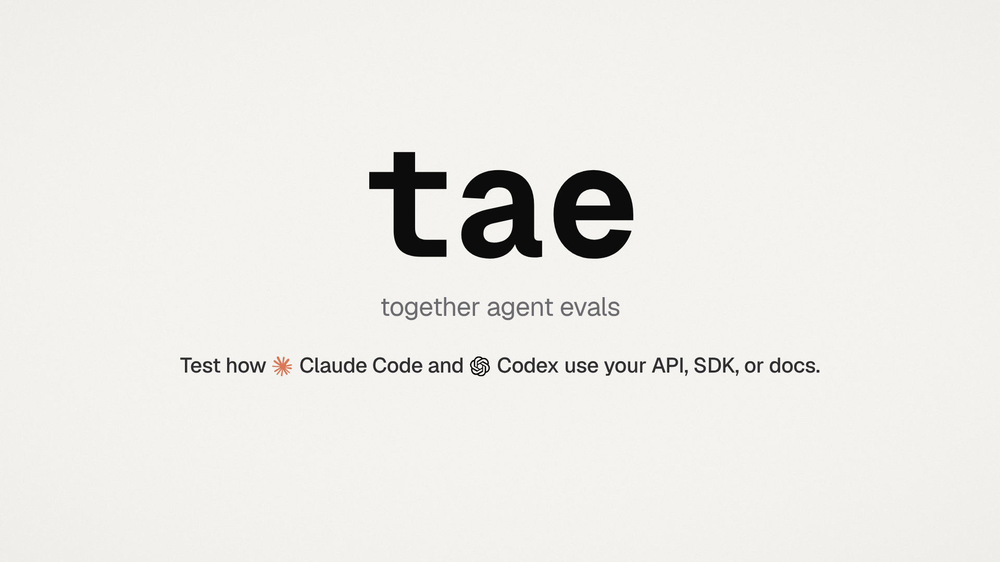

# Together Agent Evals

Test how Claude Code and Codex use an API, SDK, or documentation. Score each run
with deterministic checks, an LLM Judge, or both, then inspect the saved evidence
in a local Viewer.

## Quick start

You need Node.js 22.13 or newer, the Claude Code CLI, and either
`ANTHROPIC_API_KEY` or `CLAUDE_CODE_OAUTH_TOKEN`.

```sh
git clone https://github.com/Nutlope/together-agent-evals.git
cd together-agent-evals
cp .env.example .env.local
# Add your Anthropic API key or Claude Code OAuth token to .env.local.
npm run quickstart
```

Quickstart installs dependencies, runs one copy-message task, and opens the
Viewer. It does not need a Together key, Judge, E2B account, or database. Your
agent provider may charge for the run.

Results are saved in `.tae/results-v1`. Reopen them with:

```sh
npm run view
```

> [!WARNING]
> Local runs execute agent code on your computer with network access. They are
> not a security sandbox. Only run tasks, checks, and suites you trust.

E2B tasks can also prevent an exact expensive or destructive API request from
reaching the provider. See [request blocking](docs/authoring.md#block-an-expensive-or-destructive-request).

## Create an evaluation

```sh
npm run setup
npm --prefix harness exec -- tae init my-evals
npm --prefix harness exec -- tae validate my-evals/example.suite.mjs
npm --prefix harness exec -- tae run my-evals/example.suite.mjs --view
```

A **Task** contains a prompt, checks, and optional inputs. A **Suite** selects the
tasks, agents, models, conditions, and repeat count.

Use `checks.mjs` to evaluate what happened:

```js
import { defineChecks } from "tae";

export default defineChecks((run) => {
  run.expect.completed();

  run.expect.request({
    id: "regions",
    method: "GET",
    path: "/v1/compute/regions",
    status: 200,
  });
});
```

For an E2B Task, add an optional `guard.mjs` to prevent an exact request from
reaching the API:

```js
import { defineGuard } from "tae";

export default defineGuard((guard) => {
  guard.block.request({
    id: "no-reservation",
    method: "POST",
    path: "/v1/compute/clusters",
  });
});
```

TAE records each guard as a deterministic check. A forbidden attempt receives a
synthetic `403` and is never forwarded to the target API.

Choose one scoring mode:

- `code`: deterministic checks decide the result.
- `judge`: the Task's rubric decides the result.
- `hybrid`: both the required checks and Judge must pass.

See the [authoring guide](docs/authoring.md) and
[copy-message example](examples/copy-message/example.suite.mjs).

## Run the Together evaluations

The included Together tasks cover chat, RAG search, tool calling, and GPU
discovery without reservation.

Copy `.env.example` to the ignored `.env.local` file, then add the credentials
you use:

```sh
cp .env.example .env.local

ANTHROPIC_API_KEY=...
TOGETHER_API_KEY=...
```

Verify them before starting a paid run:

```sh
npm run preflight
```

Preflight makes small Anthropic and Together requests, so minimal provider
charges may apply. Then run one cell:

```sh
npm run hybrid -- --task rag-search --condition baseline
```

Read [Together tasks, scoring, and costs](evals/together/README.md) before
running a full Suite. These scores are not a continuation of the legacy trend.

## Optional E2B and Postgres backends

Local execution and filesystem storage are the defaults. E2B execution and
Postgres storage are opt-in beta features.

```sh
npm run setup:backends
npm run runtime:init -- e2b-postgres --template YOUR_E2B_TEMPLATE
npm run db:migrate
npm run preflight
```

See [E2B and Postgres setup](docs/beta-backends.md) for individual backend
recipes and limitations.

## Contribute

```sh
npm run setup:ci
npm test
npm run build
```

The tests do not call paid APIs. Read [CONTRIBUTING.md](CONTRIBUTING.md) before
opening a pull request. Report vulnerabilities privately using
[SECURITY.md](SECURITY.md).
